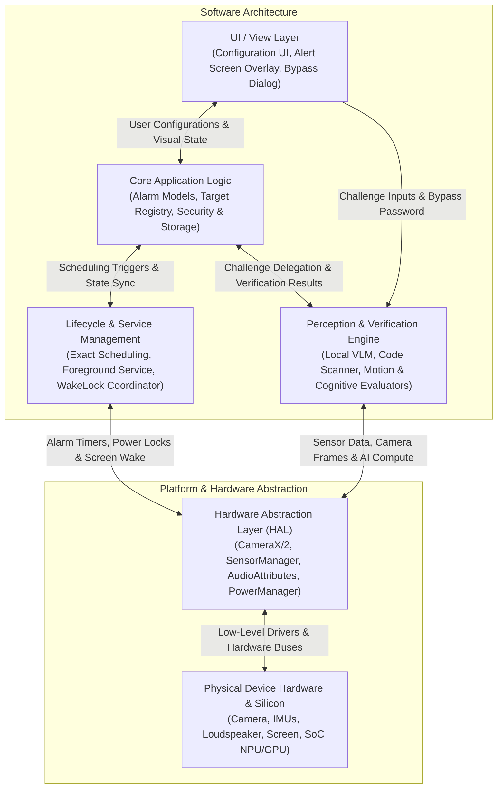
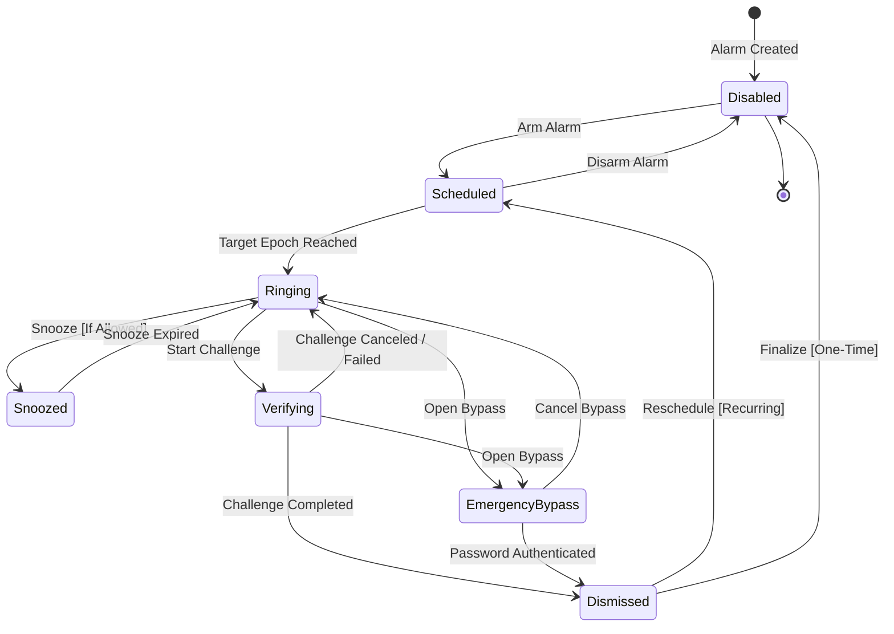
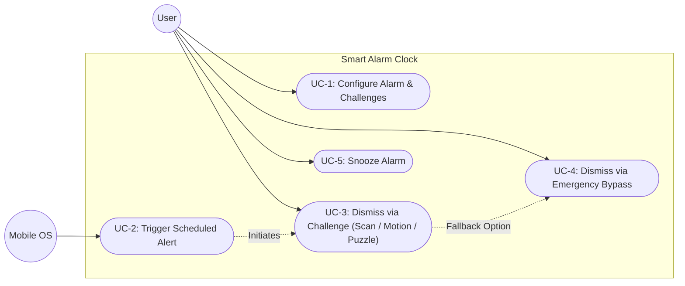

# System Requirements and UML Architecture Diagrams

This document defines the formal software-hardware codesign architecture, system requirements, and UML diagrams for the Smart Alarm Clock with Multi-Modal Verification.

---

## 1. Components View and Component Interactions

The following high-level component diagram illustrates the primary functional blocks of the Hardware-Software Codesign (HSC) architecture and the consolidated relationships between them.

### High-Level Component Interactions
* **UI / View Layer & Core Application**: Exchanges user alarm parameters, challenge bindings, and current system states between the views and persistent domain models.
* **UI / View Layer & Perception Engine**: Feeds active user inputs (camera viewfinder framing, on-screen puzzle answers, bypass credentials) directly into the verification evaluation pipeline.
* **Core Application & Lifecycle Management**: Coordinates exact OS timer scheduling, registers alarm events, and synchronizes state transitions (`SCHEDULED` -> `RINGING` -> `DISMISSED`).
* **Core Application & Perception Engine**: The core application delegates the configured verification rules (single or composite tasks) to the perception engine and receives pass/fail verification results.
* **Lifecycle Management & Hardware Abstraction Layer**: Controls system wake-locks, audio focus routing (`STREAM_ALARM`), and display illumination over the device lock screen.
* **Perception Engine & Hardware Abstraction Layer**: Streams raw camera frames, samples 50Hz inertial sensor vectors, and offloads quantized neural network inference to onboard SoC accelerators (NPU/GPU).
* **Hardware Abstraction Layer & Physical Hardware**: Standardized OS drivers bridge abstract API calls with physical mobile hardware components.

---

## 2. Main State Machine

The state machine defines the high-level operational lifecycle of an alarm instance and the primary transitions between operational states.

### State Definitions
* **Disabled**: The alarm is saved in persistent storage but has no active timers registered with the OS scheduler.
* **Scheduled**: Armed and registered with the mobile OS exact timer facility, awaiting the target trigger epoch.
* **Ringing**: Target time reached; device wakes up and plays high-priority audio over the lock screen with standard dismiss disabled.
* **Snoozed**: Alert temporarily muted; automatically re-enters `Ringing` once the snooze interval elapses.
* **Verifying**: Active challenge state where the user scans an item/code, performs physical exercise, or solves cognitive puzzles.
* **EmergencyBypass**: Last-resort fallback allowing the user to turn off the alarm by entering an authorized password.
* **Dismissed**: Verification criteria met or password authenticated; all audio/haptics stop, wake-locks release, and the session finalizes.

---

## 3. Use-Cases Diagram

The following use-case model illustrates the core functional capabilities of the system and the primary interactions with the User and the Mobile Operating System.

### Use Case Summary

| Use Case ID | Name | Primary Actor | Description |
| :--- | :--- | :--- | :--- |
| **UC-1** | Configure Alarm & Challenges | User | Defines schedule, recurrence, audio, snooze, and binds target items or actions. |
| **UC-2** | Trigger Scheduled Alert | Mobile OS | Fires exact timer, acquires CPU wake-lock, illuminates display, and enforces high-priority ringing. |
| **UC-3** | Dismiss via Challenge | User | Satisfies the assigned verification challenge (local VLM object scan, sticker code, motion, or puzzle). |
| **UC-4** | Dismiss via Emergency Bypass | User | Enters master password to immediately silence and turn off the alarm if challenges cannot be performed. |
| **UC-5** | Snooze Alarm | User | Temporarily mutes ringing within configured snooze limit count. |
